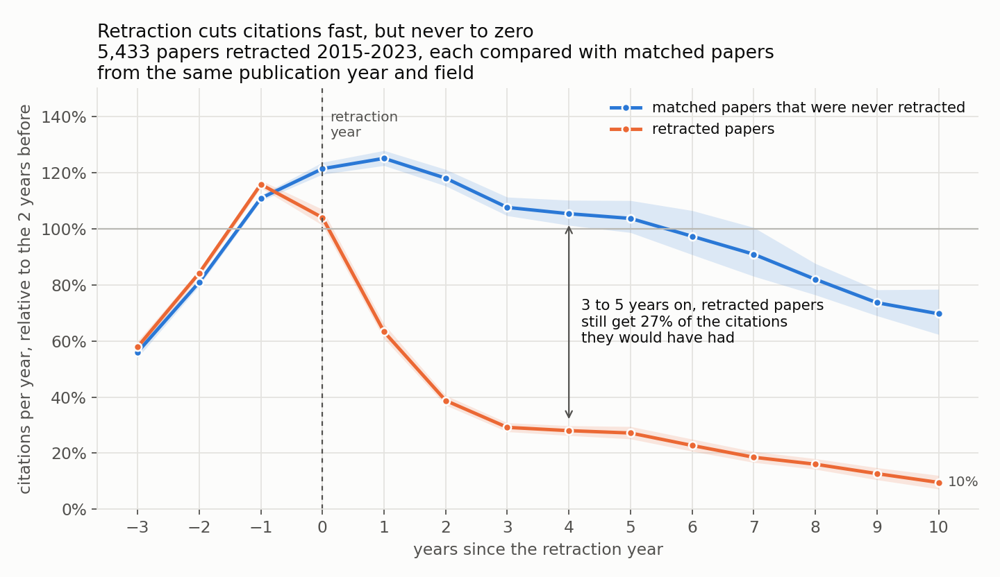
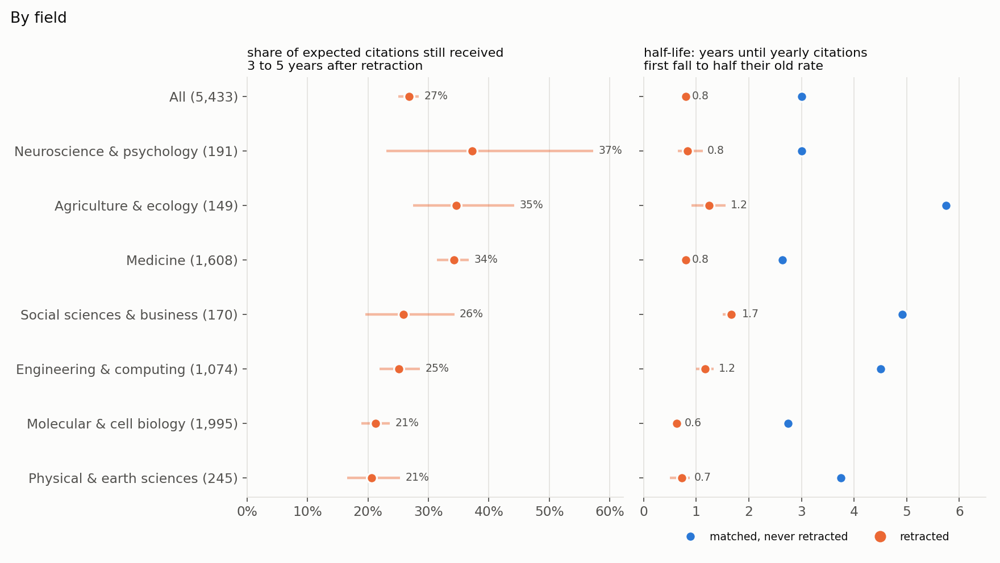
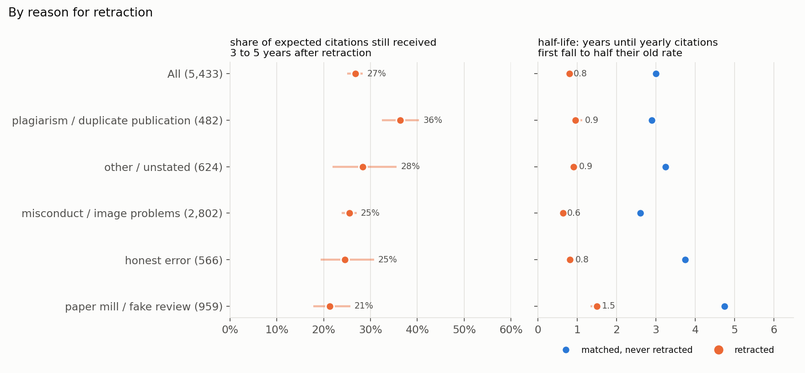
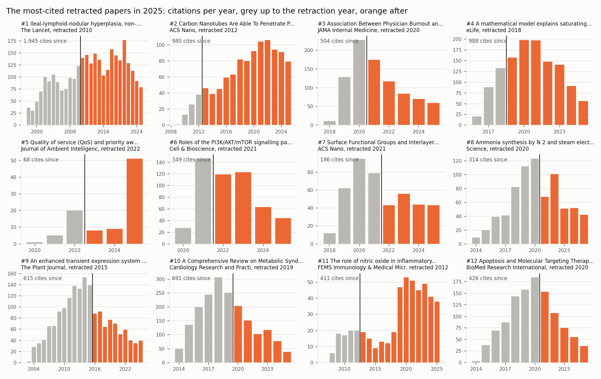

# Zombie citations

After a paper is retracted, how long do people keep citing it, and does the retraction
notice actually slow citations down? This joins the Retraction Watch database (published
openly by Crossref) to OpenAlex citation counts, and compares 5,433 retracted papers with
matched papers that were never retracted.

**Headline: the notice works, fast, but never finishes the job.** In the years before
retraction, retracted papers and their matches are cited at almost the same rate. Then the lines
split. A retracted paper's yearly citations fall to half their old rate in about **0.8
years**. Its matched papers take 3 years to drift that low on their own. But the decline
levels off well above zero. Three to five years after retraction, retracted papers still
collect **27% of the citations they would otherwise have had** (95% CI 25% to 28%). Ten years
on, it's 14%.

At scale, that's **208,330 citations since 2013** to papers already retracted by the
time the citing work came out, and **10,536 in 2025 alone** to papers retracted in 2022 or
earlier. Among the 61 most-cited of those papers checked so far, only **1.3%** of the
citations they got after retraction came from works that mention retraction in the title or
abstract. For 35 of the 61, the figure is zero.



## Findings

**1. Half-life after death is under a year everywhere, but the long tail differs by field.**
Half-life here means the time from the retraction year until a paper's yearly citations first
fall to half their pre-retraction rate (Kaplan-Meier median, interpolated between years).
It runs from 0.6 years in molecular and cell biology to 1.7 in social sciences and business.
Slower fields also fade slower without a retraction: their matched papers take 4.5 to 5
years. The more telling measure is how much citation survives in the long run. **Medicine
keeps 34%** of its expected citations 3 to 5 years after retraction (31% to 37%), against
**21%** in molecular and cell biology (19% to 24%) and in the physical sciences (17% to 25%).
Retracted medical papers are the most persistent zombies, which is where they can do the
most harm.



**2. Plagiarism retractions are cited most afterwards, paper-mill ones least.** Papers
retracted for plagiarism or duplicate publication keep 36% of their expected citations
(32% to 40%). That's arguably fair, since the findings may still be sound even if the
text was copied. Retractions for misconduct or image problems keep 25% (24% to 27%), honest
error 25% (19% to 31%), and paper mills or faked peer review 21% (18% to 26%). The groups
assign each paper by priority: misconduct and image problems first, then error, then paper
mill, then plagiarism.



**3. Some famous retractions are cited more now than when they were retracted.** Of the 61
top zombies, 25 had their peak year after the retraction year, and 23 got more citations in
2025 than in the year before they were retracted. Wakefield's 1998 Lancet paper on MMR and
autism, retracted in 2010, has 1,945 citations since its retraction and 79 in 2025, of
which 5% come from works whose title or abstract mentions retraction. A 2009 ACS Nano paper on
carbon nanotubes entering seeds was retracted in 2012 for duplicated images and text. It
peaked a decade later and still drew 79 citations in 2025. Every retraction in the top 12
was checked against Crossref's own retraction links.



The full ranked list is in [tables/top_zombies.csv](tables/top_zombies.csv), with
citations the year before retraction, citations in 2025, total since retraction, and the
share of citing works that mention retraction.

**4. The result does not depend on the analysis choices.** Across 8 variants (minimum
baseline 3, 5 or 10 citations a year; caliper 0.2, 0.35 or 0.5; same-field controls only;
early or late retraction cohorts), the share of expected citations kept 3 to 5 years
on stays between 24% and 30%, and the half-life between 0.75 and 0.83 years
([tables/sensitivity.csv](tables/sensitivity.csv)). Retracted papers ran about 4% above
their matches before retraction. Adjusting for that gap moves the headline from 27% to 26%.

## How it works

1. **Retractions.** Retraction Watch notices of type "Retraction" with a DOI. The earliest
   notice sets the retraction year. Dropped: retract-and-replace notices (the DOI still
   points to a valid paper), notices whose date is marked unknown, publisher-error
   duplicates, and papers withdrawn to publish elsewhere. 19,586 papers remain that
   OpenAlex also flags as retracted and that have 10+ citations.
2. **Citations per year.** OpenAlex `counts_by_year`, by the citing work's publication
   year. This only goes back to 2012, so the matched analysis uses retractions from 2015
   to 2023: three years before, at least two after, observed through 2025.
3. **Treated set.** Papers drawing at least 3 citations a year in the two years before
   retraction (their baseline). 5,516 papers, 5,433 matched.
4. **Controls.** A random pool of 32,200 non-retracted articles and reviews with 10+
   citations, drawn for each publication year from 2000 to 2022 in four citation bands. The
   bands were sampled at fixed sizes, so each control carries a weight equal to its band's
   population over the sample size. Without the weights, highly cited papers are heavily
   overrepresented, and the counterfactual climbs to twice the baseline. Each treated paper
   is matched to every pool paper from the same publication year and field whose citations
   in the three years before retraction are within 0.35 on a log scale (RMS), up to 60
   nearest. If fewer than 3 qualify, the match falls back to any field. That gives a median
   13 controls per paper, effective 9.7. Controls get the treated paper's retraction year as
   a pseudo-date, so both are measured over the same calendar years.
5. **Effect.** At each year since retraction, the treated papers' summed citations and the
   synthetic controls' summed citations, each divided by the treated papers' summed baseline.
   The ratio is the share of expected citations still received. CIs come from 400 bootstrap
   resamples of papers.
6. **The ranked list.** Every paper retracted by 2022, ranked by 2025 citations. For the
   top papers, OpenAlex returns citing works grouped by year back to publication, and the
   subset whose title or abstract matches `retract*`.

## Running it

```bash
pip install -r requirements.txt
```

```bash
python fetch.py && python build.py && python zombies.py
```

```bash
python analysis.py && python sensitivity.py && python figures.py && python report.py > out/summary.md
```

```bash
python -m pytest
```

`fetch.py` downloads Retraction Watch (67 MB) and makes about 320 OpenAlex calls.
`zombies.py` makes two calls per paper. Search calls cost more than lookups, and without a key
OpenAlex allows about $0.10 of calls a day. Every response is cached in `data/cache/`, so if
the budget runs out, rerun after it resets and the script continues from where it stopped.
Set `OPENALEX_API_KEY` for a larger budget, and optionally `OPENALEX_MAILTO`. The ranked list
currently covers the top 61 of a planned 150 for that reason. Rerun `zombies.py`, then
`figures.py` and `report.py`, to finish it. The analysis itself takes about 3 minutes, and
the tests need none of the data.

| file | role |
|---|---|
| `openalex.py` | cached OpenAlex client that tracks the daily budget |
| `fetch.py` | Retraction Watch CSV, retracted works, weighted control pool |
| `build.py` | the join and every rule about which retractions count; reason groups |
| `analysis.py` | caliper matching, event study, half-life Kaplan-Meier, field and reason tables |
| `sensitivity.py` | reruns the main estimates with one choice changed each time |
| `zombies.py` | the ranked list and per-paper citing history |
| `figures.py`, `report.py` | figures, and every number quoted here |

## Limits

- **"As if it were still valid" is not measured directly.** That needs the citing
  sentence, and OpenAlex has no full text. Mentioning retraction in the title or abstract
  is a lower bound on awareness. A paper can flag a retraction in its text, or cite a
  retracted paper to criticise it, without saying so in the abstract. The 1.3% figure
  should be read that way.
- **Year resolution.** OpenAlex counts citations by calendar year of the citing work, and
  the retraction year itself is partly before and partly after. Papers in press at the time
  of a retraction show up as citations after it.
- **Coverage.** Only papers OpenAlex flags as retracted, that join to a Retraction Watch
  retraction by DOI, and that have 10+ citations (20,799 of the 29,227 flagged works with
  10+ citations join). The control pool applies the same 10+ citation floor.
- **Field.** Fields come from OpenAlex's topic classifier, grouped into 7 broader areas, and
  22% of papers were matched to controls from another field in the same year.

## Data

Retraction Watch database, published by Crossref. OpenAlex (CC0). Both fetched October 2026.
